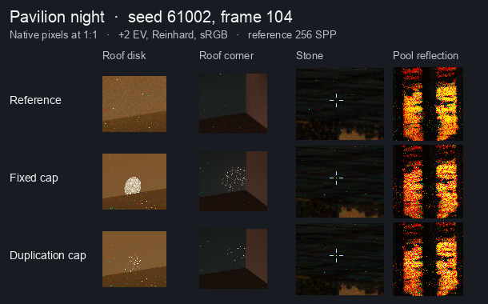

# Duplication-based confidence on M4 Max

We tested whether the duplication cap in section 5 of *ReSTIR PT Enhanced*
could suppress bright clusters on the Pavilion night roof and stone while
preserving the lantern and its reflected ripples. The cap reduces the
historical weight when the selected seed has spread to neighboring pixels.
An isolated sample can retain the full historical weight. The largest cap in
this experiment is 20. Keep the fixed cap as the default. The adaptive policy
reduced a spatial cluster, but the worst local outlier persisted and denoised
whole-image error increased on both native night seeds.
[Estimator contract](restir-enhanced.md#temporal-confidence-policies)

## Native comparison

Both policies run the same four-wavelength visible-hero wavefront tracer at
1920×1080 with native Metal ray queries, one fresh path per pixel, one shared
reciprocal spatial map, no mutations and signed temporal reconstruction.
Each process warms up for eight frames and measures the next 96. Raw and
denoised captures come from the last completed frame. Frame times include
reconstruction and exclude startup and image readback.

The independent reference averages four 64-SPP batches at each pixel.
All metrics use unclamped signed linear RGB. The native policies run in
separate processes with separately built acceleration structures.
Pavilion has coincident geometry, so differences between independently built
structures can affect some pixels. The same-AS GPU tests exercise the cap
directly on bounded fixtures.

The native comparisons below use seed 61002. The MSE columns compare the final
denoised image to the independent 256-SPP mean.

| Scene | Fixed ms | Adaptive ms | Fixed FPS | Adaptive FPS | Fixed signed MSE | Adaptive signed MSE |
| --- | ---: | ---: | ---: | ---: | ---: | ---: |
| Cornell | 454.39 | 460.81 | 2.201 | 2.170 | 0.001007 | 0.001006 |
| Prism | 584.92 | 593.66 | 1.710 | 1.684 | 0.004230 | 0.004294 |
| Pavilion day | 1145.15 | 1158.29 | 0.873 | 0.863 | 1.258221 | 1.582921 |
| Pavilion night | 1188.30 | 1198.48 | 0.842 | 0.834 | 0.362525 | 0.421240 |

On the first Pavilion night seed (61002), the denoised roof crop's mean
luminance fell from 0.0894 to 0.0549. The four reference batch means span
0.0290–0.0358. The reflected lantern changed from 0.3324 to 0.3510 against a
reference range of 0.3247–0.3758. At stone pixel (1300, 650), the denoised
red channel was 534.72 with either policy. Pixels with an absolute RGB
channel above 100 in regions where the reference stayed below one increased
from 10 to 12. Raw full-frame MSE rose from 1.8202 to 3.2666 and signed
denoised MSE from 0.3625 to 0.4212. Both increases held against each of the
four reference batches. These are finite-sample image differences. Measuring
the expected bias of this estimator requires a converged ensemble.

The crosshairs locate stone pixel (1300, 650). Presentation applies +2 EV,
Reinhard and sRGB to each image. The signed float measurements above precede
that transform. The figure crops and annotates our renders of the Barcelona
Pavilion by Hamza Cheggour (CC BY 2.0), with landscape assets by
Jan-Walter Schliep, Burak Kahraman and Timm Dapper / Laubwerk (CC BY 4.0)
and CC0 data from the RGL Material Database.
[Pinned sources and attribution](../tests/corpus/pbrt-pavilion.json) ·
[CC BY 2.0](https://creativecommons.org/licenses/by/2.0/) ·
[CC BY 4.0](https://creativecommons.org/licenses/by/4.0/)

A separate readback trace followed 360 prespecified samples inside the first
roof patch through all 104 frames. With the fixed cap, mean raw luminance
exceeded twice the reference in 46 frames. With the duplication cap it did
so in 12. The signed reconstruction exceeded that threshold in 100 frames
under either policy, although its final grid mean fell from 0.1223 to
0.0648 against a 0.0292 reference. Thus the cap reduced the duration of the
raw excursion, while the denoiser continued displaying some of its early
energy. The trace uses a sparse grid, and the crop means above use every
pixel in the rectangle.

A sparse readback of the published reservoir and its ancestry explains the
unchanged stone pixel. At (1300, 650), every one of the 104 publications
selected the pixel's own initial seed from frame 1. Independently recounting
its 17×17 neighborhood from the published labels gave zero matching neighbors
on all 104 frames. The effective adaptive maximum therefore stayed at 20.
It limited structural history confidence on 102 frames, exactly as a fixed
cap of 20 would. Raw red fell from 3,459.15 to 19.89, while signed red ended
at 534.7164. The sparse diagnostic reproduced the normal adaptive endpoint
bit for bit at all seven inspected pixels. Spatial duplication and temporal
persistence are different properties of this sample.

A second native seed (61003) measured raw MSE of 2.1221 with the fixed cap
and 2.4973 with the duplication cap. Denoised MSE changed from 0.4404 to
0.4485. The brightest reconstructed channel was about 828 in both images.
The roof disk was already close to the reference with the fixed policy on
this seed. On both native seeds, the reflected pool ripples retained their
reference-aligned contrast under the duplication policy. Errors in the
fine and medium ripple bands increased against all four reference batches.

## Held-out scenes and texture detail

Eight held-out evaluation seeds (indices 200–207) ran 32 static frames per
policy and scene. The table compares mean signed denoised MSE across frames.
The last column counts seeds that favored the adaptive policy. Each paired
95% Student interval is in absolute MSE units and is conditional on this
finite reference and these process builds.

| Scene | Relative MSE change | Interval for adaptive minus fixed | Lower MSE seeds |
| --- | ---: | ---: | ---: |
| Cornell | −2.25% | [−0.001150, −0.000007] | 8/8 |
| Prism | +0.37% | [−0.002338, 0.003199] | 6/8 |
| Pavilion day | −0.0013% | [−0.003007, 0.000045] | 8/8 |
| Pavilion night | −0.0015% | [−0.01567, 0.01527] | 5/8 |

The static cohorts use 320×180 for Cornell and Prism and 320×170 for
Pavilion. The independent-PT cold and final raw and signed images were
bitwise equal between policy processes on every seed across all four scenes.
The 2048-SPP endpoint reference shares sample prefixes with the 128-SPP
reference. Both use seeds separate from evaluation.

In a separate Pavilion night camera translation and cut sequence using those
eight seeds, the mean denoised MSE was 6.9425 with the fixed policy and
6.9096 with the duplication policy. Seven of eight moving seeds favored duplication.
The paired 95% Student interval for this moving difference was
[−0.0706, 0.0049]. The independent-PT cold and final raw and signed images
were also bitwise equal across the moving controls. These intervals describe variation across seeds in the sampled
scene and camera sequence.

For the preselected Pavilion day texture crops, the adaptive-to-fixed
medium-band ratio of reference-aligned contrast was 1.001 on the marble
slab, 1.012 on the left wall and 0.948 on the stone floor. The floor's gain
relative to the reference moved from 1.030 to 0.977, with lower band error
against all four reference batches. Lower contrast alone would give a
misleading account of that surface.

## Reproduce the comparison

Use the native frame benchmark command in the [zero-mutation study](zero-mutation-performance.md#reproducing-a-native-run)
with `--area-history-cap 20`, first with `--area-history-cap-policy fixed`
and then with `--area-history-cap-policy duplication`. Use distinct report
and capture paths. Both flags also work in the qualifier and viewer. The
benchmark reports the effective policy, initial-seed key, duplication
histogram and cap parameters. The qualifier keeps its independent-PT arm
on the fixed policy.

Lin et al. reported an increase from 12.9 to 13.6 ms and 3.25% average
absolute relative bias in their moving Kitchen example. Our spectral
film/lens estimator, scenes, GPU and accuracy measurements differ from theirs.
[Lin et al., figure 5 and section 5](https://research.nvidia.com/labs/rtr/publication/lin2026restirptenhanced/lin2026restirptenhanced.pdf)
