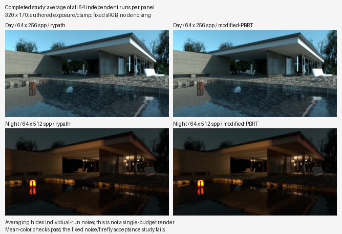

# Pavilion convergence follow-up

The remaining investigation is **deferred from PR #51 at the maintainer's request
on 2026-11-22**. The implementation, full-size images and controlled performance
study are complete. Quality qualification failed and remains failed. Readiness
for review concerns the delivered fixes; it does not certify PBRT parity,
unbiasedness, equal converged images or time to a shared quality target.

Track the remaining work in [issue #52](https://github.com/rlefko/rypath/issues/52).
Merging PR #51 does not close that issue.

## Starting point

Use implementation revision `2cba19f4ed4a875a2044b2cc23bf8dde433c7b50`, contracts
**3/12/27/9/2** (checkpoint/identity/renderer/sampling/accumulation). The candidate is
vacuum packet PT with eta-compensated outer roulette, maximum depth 5 and finite
coating depth 10 with one internal sample. The reference is the original
RR-enabled `matched-reference-21-002` modified PBRT, with documented importance
adjoint, one-sided emission-support and layered reverse-MIS repairs. It is not
stock PBRT and is not the no-roulette diagnostic control. Finite coating,
represented/sampled PDF conventions, proxy densities and numerical support remain
model limitations. See [roulette validation](packet-roulette-validation.md) and
the [historical closure record](pavilion-closure-validation.md).

The pinned scene revision is `30cf4a0346ae5a80a2d7a530a3ef7d0fa4f70572` from
`mmp/pbrt-v4-scenes`; PBRT base revision is
`b0bdf461ba5dd6504b70ebf0932acc0fe7aa744f`. Recorded M4 Max tooling is Xcode 26.6
(build 17F113), Apple Clang 21.0.0 and Metal 32023.883; complete recipes and
source/tool identities are retained with the release receipt.

## Completed quality study

The fixed 320×170 study uses day 256 spp and night 512 spp, 64 independent
replicates per arm and scene, and 20,000 complete-image bootstrap draws. Candidate
seeds **1024–1087** and reference seeds **2048–2111** are now consumed. Earlier
renderer26 seeds 256–319 and 512–575 also remain consumed. The pre-study ledger
is historical; a future study must include these completed runs when establishing
unused seeds. No seed was removed, replaced or rerendered to obtain acceptance.

All **384 native processes exited successfully**, including 192 day and 192 night
captures. All 256 records completed. All 1,836 retained files (2,167,993,622 bytes)
were authenticated, and a separate retained-image reduction reproduced the point
statistics. Independent review checked record coverage and statistical formulas.
The metric helper exited 0; the enclosing analyzer exited 1 because numerical
acceptance failed. There was no GPU, rendering or retention failure.

- **36/36 raw regional RGB mean safeguards pass.** These use five combined
  standard errors plus an absolute floor; they are not equivalence tests.
- **0/48 simultaneous noise upper bounds pass.** The common log margin is
  **5.529009736739411**, multiplying every point ratio by approximately **251.894**.
  This does not establish 48 independent physical regressions. The driver of this
  current-run margin has not been localized.
- **42/48 point ratios are at most 1.25**, including all 12 day-clamped endpoints.
  The six excesses are day/raw pool variance and tail, day/raw glass variance and
  tail, night/raw wall tail, and night/clamped glass tail. These are observed point
  excesses, not established causal regressions.

The exact [48 noise endpoints and 36 mean safeguards](evidence/pavilion-renderer27/quality-metrics-v2.json)
are preserved without modification. The [statistical settings excerpt](evidence/pavilion-renderer27/study-settings.json)
and [descriptive seed/pixel localization](evidence/pavilion-renderer27/localization.json)
are portable evidence, not executable launch plans. The latter includes all
replicates in every reduction; its rankings do not establish a transport cause.

### Point ratios: rypath / modified PBRT

These estimates describe noise about each renderer's own ensemble mean. They do
not measure the difference between the two limiting images. All associated
simultaneous upper bounds fail.

| Scene / plane | Region | Variance | Positive-tail energy |
| --- | --- | ---: | ---: |
| day/raw | full | 1.184655 | 1.178102 |
| day/raw | wall | 1.202855 | 0.765956 |
| day/raw | soffit | 0.157752 | 0.005262 |
| day/raw | floor | 1.084520 | 0.651898 |
| day/raw | pool | 1.408006 | 1.406504 |
| day/raw | glass | 2.072963 | 2.074723 |
| day/clamped | full | 1.108639 | 1.037561 |
| day/clamped | wall | 1.201015 | 0.671382 |
| day/clamped | soffit | 1.064638 | 0.661010 |
| day/clamped | floor | 1.124740 | 0.920949 |
| day/clamped | pool | 1.091091 | 1.189796 |
| day/clamped | glass | 1.164708 | 1.156025 |
| night/raw | full | 0.957688 | 0.951939 |
| night/raw | wall | 0.820598 | 3.209864 |
| night/raw | soffit | 0.753875 | 0.782735 |
| night/raw | floor | 0.027212 | 0.016561 |
| night/raw | pool | 0.939447 | 0.940694 |
| night/raw | glass | 0.977287 | 0.812877 |
| night/clamped | full | 0.957001 | 1.013081 |
| night/clamped | wall | 0.688767 | 1.033172 |
| night/clamped | soffit | 0.996109 | 0.995576 |
| night/clamped | floor | 0.717731 | 0.701126 |
| night/clamped | pool | 0.993553 | 1.018320 |
| night/clamped | glass | 1.116255 | 1.310014 |

### What remains uncertain

Passing the mean safeguards does not rule out bias. For example, day-pool raw
red is **21.65% above reference**, with a combined standard error of **12.16% of
reference** and a passing threshold of **61.09%**. This study does not establish
equal regional means, let alone pixelwise equivalence. High variance can conceal
bias; it can also occur with correct weights and an unchanged expected result.

Per-sample clamping is nonlinear: different proposals or roulette decisions can
produce different limiting clamped means even when raw expectations agree.
Adding roulette is therefore not a promise of lower raw per-sample variance.
The prior controlled reference experiment explains the renderer26 daytime pool
clamped discrepancy in its fixed population: disabling only outer roulette changes
variance/tail ratios from **1.3229/4.5938** to **0.9984/0.9720**. This neither proves
current-run raw parity nor explains every region or night-time discrepancy.

A confirmed secondary specular texture-footprint difference remains unimplemented.
The candidate approximates secondary footprints from the camera; PBRT propagates
valid ray differentials through smooth reflection/refraction and clears them after
non-specular scattering. A water-to-textured-pebbles path can consequently evaluate
different filtered material values. Its Pavilion bias/variance effect is unmeasured.
A source-only design is retained; its planned runtime diagnostic has not run.

Other retained limitations include finite layered scattering and proxy PDFs,
within-renderer floor BDPT/PT differences, remaining process cost, and the absence
of an equal-time comparison against a shared quality target. Earlier selected
path replays found finite throughput/PDF values and the expected post-specular
MIS weight; this does not clear every rare path or establish general unbiasedness.

## Completed performance and images

The fixed performance study completes all **48 captures, 48 same-arm exact-output
audits and six 64-spp acceptance gates**, retaining warm-ups and all five measured
pairs per group. At 320×170, render/accumulation means in seconds are:

| Workload | Frozen fast renderer14 | Renderer27 | Interpretation |
| --- | ---: | ---: | --- |
| Day 64 spp | 7.077242 | 3.690122 | 47.9% reduction; formal gate |
| Night 64 spp | 12.986480 | 10.690580 | 17.7% reduction; formal gate |
| Day 256 spp | 27.874480 | 14.325800 | Descriptive higher-budget result |
| Night 512 spp | 103.421600 | 87.153200 | Descriptive; current sample SD 3.009847 s |

These compare rypath revisions, not PBRT speed or time to equal image quality.
All 433 retained files (626,956,299 bytes) were authenticated. No timing outlier
was removed. Within-arm exactness is not cross-renderer image equality.

The **1600×850 day-256/night-512** fixed-seed images and four modified-PBRT
raw/clamped companions are complete: six successful native captures, three output
audits and 212 authenticated files (1,067,458,633 bytes). They retain raw FLOAT EXRs
and authored-clamped previews, using seed 0, authored exposure and standard sRGB
without denoising. They are illustrations, not statistical quality acceptance.

The portable preview below instead averages all **64 study runs per panel** before
standard sRGB, at 320×170. Averaging hides individual-run noise. Left is rypath,
right is modified PBRT; top is day and bottom is night. Its caption's mean-color
checks refer specifically to the 36 raw RGB safeguards.

Scene attribution: Barcelona Pavilion by
[Hamza Cheggour](https://www.emirage.org/2013/04/24/free-download-archviz-project-pabellon-barcelona-3d-scene-v1-2-updated/),
[CC BY 2.0](https://creativecommons.org/licenses/by/2.0/); landscape assets by
Jan-Walter Schliep, Burak Kahraman and Timm Dapper (Laubwerk),
[CC BY 4.0](https://creativecommons.org/licenses/by/4.0/); measured materials from
the RGL Material Database, CC0. These are rendered, averaged and labeled derivatives.
The [pinned asset manifest](../tests/corpus/pbrt-pavilion.json) retains full provenance.

## Retention and reproduction

The [artifact index](evidence/pavilion-renderer27/artifact-index.json) pins the
actual source, binaries, protocol, analysis, review and archive manifests. The
portable JSON and preview above are committed; large native captures, checkpoints,
external scene assets and local execution records are deliberately outside Git.

A separately verified local archive is at
`../rypath-evidence/pr51-2026-11-22-002/` relative to the durable checkout. It
preserves 5,658 files (8,536,339,473 bytes), including the latest and renderer26
quality studies, roulette controls, margin and footprint findings, final images
and timing, selected inputs, exact candidate binaries and a source snapshot.
`manifest.json` records each file's relative path, size and SHA-256. Verify that
manifest against the tracked index before restoring files. This is local storage,
not a remote backup or a self-contained toolchain installation; a fresh clone
needs access to this archive for the full native evidence. Earlier payloads remain
at the locations in the historical validation records. Preserve those caches until
any future archival transfer is verified.

Original artifact roots relative to the checkout:

| Evidence | Location under `.cache/pavilion-closure/` |
| --- | --- |
| Exact frozen inputs and model review | `packet-roulette-integration-027-001/quality-inputs-001/` and `ROOT-quality-model-review-001.json` in its parent |
| Current quality records, logs, 512 EXRs and checkpoints | `quality-v2-supervision-027-prep-001/runtime-attempt-001/` |
| Actual quality review, image reduction and rankings | `quality-results-review-027-001/` |
| Earlier failed quality study and margin diagnosis | `quality-v2-supervision-prep-001/` and `quality-margin-diagnostic-001/` |
| Controlled reference roulette traces and population | `quality-reference-roulette-trace-021-001/` and `quality-reference-roulette-population-021-001/` |
| Unimplemented specular-footprint design | `specular-footprint-027-investigation-001/README.md` |
| Final image captures and audits | `final-images-027-prep-001/runtime-attempt-001/` |
| Fixed performance captures and audits | `final-timing-roulette-027-prep-001/runtime-attempt-001/` |
| Exact model/build provenance | `final-model-bindings-027-prep-001/` and `final-release-roulette-027-prep-001/` |

Execution receipts retain exact commands and dependency hashes. Historical absolute
paths and toolchain bindings must be reconciled before replay; do not execute an
old plan against a newly built renderer. The statistical implementation is
`scripts/compare_pavilion_quality_v2.py`, `tests/pavilion_quality_metrics_v2.cpp`
and `tests/pavilion_quality_bootstrap_v2.hpp` at the pinned implementation revision.

## Resume in bounded steps

1. Authenticate the retained baseline and reproduce the existing reductions.
   Localize the current shared bootstrap-margin driver and the six point excesses
   from existing samples. The earlier renderer26 margin diagnosis is not evidence
   about which samples drive renderer27's margin.
2. Replay selected retained extreme paths and compare actual contribution,
   continuation probability, spectral throughput, MIS/PDF terms, geometry and
   filtered texture values. Separate raw transport correctness from the authored
   clamp's effect. Selection is diagnostic, not new population acceptance.
3. Isolate the specular footprint policy on a reduced textured receiver behind
   smooth reflection/refraction. Independently check differential propagation,
   actual sampled eta, normal derivatives, null boundaries and non-specular resets
   before attributing a Pavilion difference or integrating a production change.
4. Define a useful raw-mean equivalence tolerance and a sufficiently powered
   comparison before new outcomes. Include local image differences; passing broad
   regional five-standard-error safeguards is insufficient to establish parity.
5. After any justified fix, run appropriate analytic/native checks and any required
   contract updates. Freeze the declared model, inputs and genuinely unused seed
   inventory before a new quality study. Preserve this failed result and the
   unchanged 48-noise/36-mean/20,000-draw protocol; any redesigned study must be
   explicitly separate and justified, never a relabeling of this failure.
6. Revisit time to the same raw-image quality target after the correctness and
   quality questions are sufficiently resolved. The completed throughput study
   alone does not provide that result.

No new experiment is scheduled as part of this deferral. Broader PBRT compatibility
and offline MVP acceptance remain on the roadmap.
